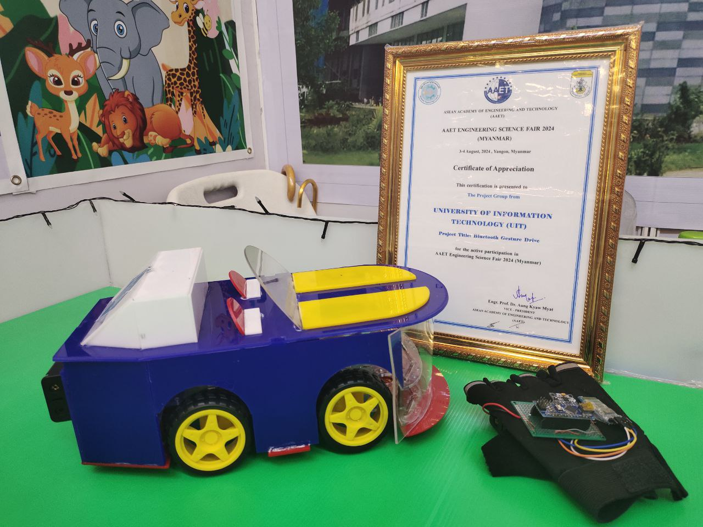

# Arduino Gesture-Controlled Robot Car (HC-05)

An intuitive, wireless gesture-controlled 4WD robot car powered by Arduino, an MPU6050 accelerometer/gyroscope, and a pair of HC-05 Bluetooth modules configured in Master-Slave mode.



---

## 👥 Team
This project was proudly assembled, programmed, and tested by **Team Podracers** (a 7-member team).

---

## 🙏 Credits & Acknowledgments
This project is inspired by and directly adapted from the excellent guide by **Robot LK**:
* **Website Tutorial**: [How to Build Arduino Gesture Controlled Car HC-05 - Robot LK](https://robotlk.com/how-to-build-arduino-gesture-controlled-car-hc-05/)
* **Creator / Channel**: [Robot LK on YouTube](https://www.youtube.com/@RobotLk)

Full credit to Robot LK for the original circuit design, logic, and reference implementations.

---

## 📁 Repository Structure
```text
bluetooth-gesture-drive/
├── achievement.jpg              # Team Podracers project showcase photo
├── README.md                    # Project documentation & guide
├── transmitter/                 # Hand Gesture Glove (Transmitter)
│   ├── transmitter.ino          # Arduino Nano transmitter sketch
│   ├── I2Cdev.h / I2Cdev.cpp    # I2C communication library
│   ├── MPU6050.h / MPU6050.cpp  # MPU6050 driver library
│   ├── MPU6050_6Axis_MotionApps20.h
│   └── helper_3dmath.h
└── receiver/                    # 4WD Robot Car (Receiver)
    └── receiver.ino             # Arduino Uno receiver sketch
```

---

## 📦 Required Components

### Transmitter (Glove / Remote)
* 1x Arduino Nano
* 1x MPU6050 (GY-521) 6-Axis Accelerometer & Gyroscope
* 1x HC-05 Bluetooth Module (configured as **Master**)
* Power source (e.g., 3.7V Li-ion or 9V battery)
* Glove or wearable strap & jumper wires

### Receiver (Robot Car)
* 1x Arduino Uno
* 1x 4WD Smart Car Chassis Kit (4 DC motors + wheels)
* 1x L298N Dual H-Bridge Motor Driver
* 1x HC-05 Bluetooth Module (configured as **Slave**)
* External Battery Pack (e.g., 2x 18650 Li-ion cells / 7.4V - 12V)
* Power switch and jumper wires

---

## 📚 Required Libraries

1. **SoftwareSerial** (Included with standard Arduino IDE) – Used for Bluetooth serial communication.
2. **Wire** (Included with standard Arduino IDE) – Used for I2C communication with MPU6050.
3. **I2Cdev** (Included in `transmitter/` directory) – Fast I2C abstraction layer by Jeff Rowberg.
4. **MPU6050 (MotionApps v2.0)** (Included in `transmitter/` directory) – Handles on-chip DMP (Digital Motion Processor) to read tilt angles without complex filtering.

> *Note: The transmitter libraries (`I2Cdev` and `MPU6050`) are placed directly in the `transmitter/` sketch directory so the sketch compiles out of the box.*

---

## 🔌 Wiring Connections

### 1. Transmitter (Hand Glove)
| Component Pin | Arduino Nano Pin | Note |
|---|---|---|
| **MPU6050 VCC** | 5V | Power |
| **MPU6050 GND** | GND | Ground |
| **MPU6050 SDA** | A4 | I2C Data |
| **MPU6050 SCL** | A5 | I2C Clock |
| **MPU6050 INT** | D2 | External Interrupt 0 |
| **HC-05 VCC** | 5V | Power |
| **HC-05 GND** | GND | Ground |
| **HC-05 TXD** | D10 | SoftwareSerial RX |
| **HC-05 RXD** | D11 | SoftwareSerial TX |

---

### 2. Receiver (Robot Car)
| Component Pin | Arduino Uno Pin | Note |
|---|---|---|
| **HC-05 VCC** | 5V | Power |
| **HC-05 GND** | GND | Ground |
| **HC-05 TXD** | D10 | SoftwareSerial RX |
| **HC-05 RXD** | D11 | SoftwareSerial TX |
| **L298N IN1** | D5 | Left Motors Direction |
| **L298N IN2** | D6 | Left Motors Direction |
| **L298N IN3** | D3 | Right Motors Direction |
| **L298N IN4** | D9 | Right Motors Direction |
| **L298N GND** | GND | Common Ground with Battery & Arduino |

**Motor Driver to Motors & Power:**
* **OUT1 & OUT2**: Left side DC motors
* **OUT3 & OUT4**: Right side DC motors
* **12V / Power Terminal**: Battery (+) positive terminal
* **GND Terminal**: Battery (-) negative terminal and Arduino GND

---

## 🛠️ Step-by-Step Guide

### Step 1: Pair HC-05 Modules (Master & Slave)
1. Put the first HC-05 module into **AT Command Mode** (hold the module button while powering on).
2. Configure it as **Slave**:
   ```text
   AT+ROLE=0
   AT+UART=9600,0,0
   AT+PSWD="1234"
   AT+ADDR?   <-- Note down the slave MAC address (e.g. 98d3:31:f94112)
   ```
3. Put the second HC-05 module into AT Command Mode and configure as **Master**:
   ```text
   AT+ROLE=1
   AT+CMODE=0
   AT+UART=9600,0,0
   AT+PSWD="1234"
   AT+BIND=98d3,31,f94112   <-- Use commas instead of colons
   ```
4. Once configured, both modules will automatically link whenever powered up.

---

### Step 2: Assemble the Car Chassis
1. Assemble the 4WD chassis and mount the 4 DC gear motors.
2. Secure the Arduino Uno, L298N motor driver, and battery pack onto the chassis.
3. Wire the left and right motors in parallel to L298N `OUT1/OUT2` and `OUT3/OUT4`.
4. Connect the L298N logic pins and power according to the wiring table.

---

### Step 3: Build the Gesture Glove (Transmitter)
1. Mount the Arduino Nano, MPU6050, and Master HC-05 module onto a glove or wearable strap.
2. Ensure the MPU6050 is oriented flat relative to the back of the hand.
3. Complete the wiring between MPU6050, HC-05, and Arduino Nano.

---

### Step 4: Upload the Code
1. Open [`transmitter/transmitter.ino`](transmitter/transmitter.ino) in the Arduino IDE.
   - Select Board: **Arduino Nano**.
   - Processor: **ATmega328P** (or **ATmega328P (Old Bootloader)** if flashing fails).
   - Upload the sketch.
2. Open [`receiver/receiver.ino`](receiver/receiver.ino) in the Arduino IDE.
   - Select Board: **Arduino Uno**.
   - Upload the sketch.

---

### Step 5: Test & Drive
Power on both the transmitter glove and the robot car. Once the Bluetooth modules connect (LED blinking changes to a slow sync pulse):
* **Tilt Forward**: Robot drives forward (`'F'`)
* **Tilt Backward**: Robot drives in reverse (`'B'`)
* **Tilt Left**: Robot turns left (`'L'`)
* **Tilt Right**: Robot turns right (`'R'`)
* **Hand Level / Flat**: Robot stops (`'S'`)

